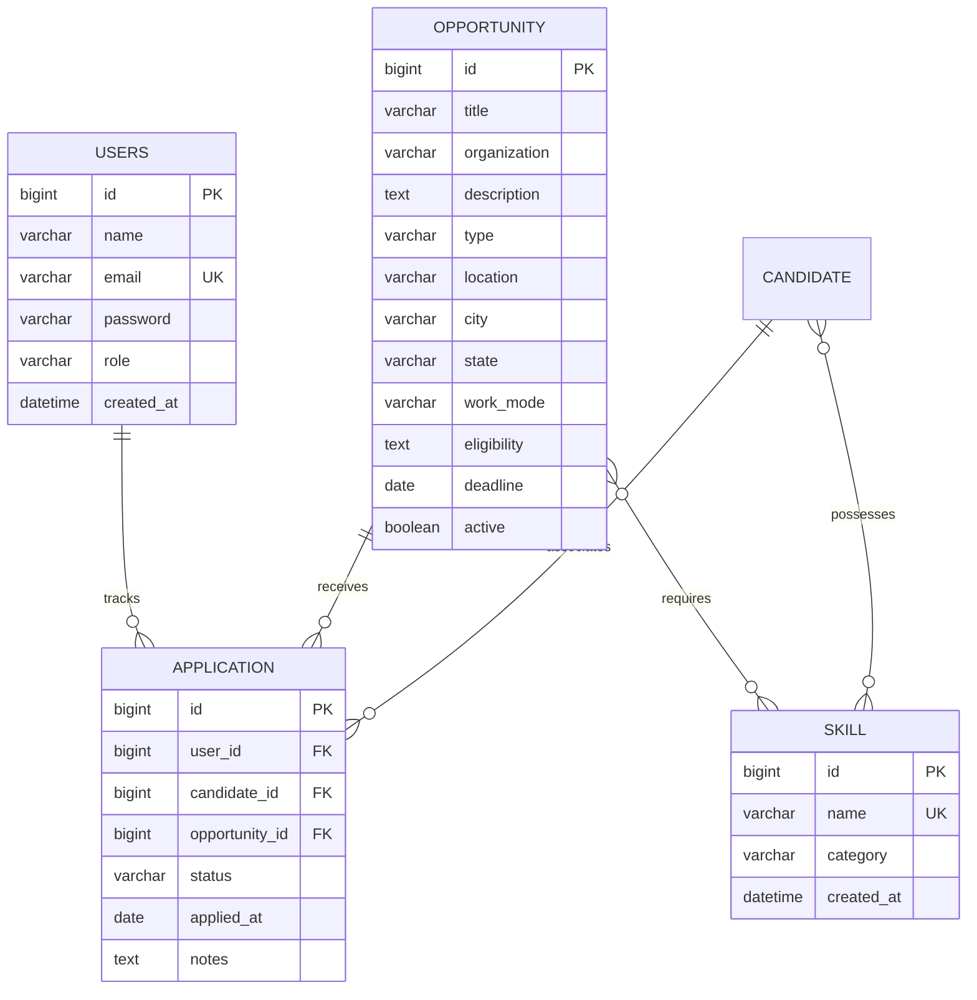

# CareerOps – Career Opportunity Management System

> **Academic REST API Mini-Project & Real-World Career Operations Platform**  
> Built with **Spring Boot 3.3.4**, **Spring Data JPA**, **MySQL 8+**, **Spring Security 6 (JWT + BCrypt)**, and **React 18 (Vite)**.  
> Developed for college REST API mini-project requirements: 4 Entity classes, Repository-Service-Controller layers, full CRUD, Derived & JPQL queries, Pagination, Sorting, JPA relationships, Jakarta Validation, Global Exception Handling, Swagger/OpenAPI, JWT authentication, SLF4J logging, and automated testing.

---

## 1. Project Overview & Problem Statement

### 1.1 Problem Statement
1. **Fragmented Opportunities**: Students and job seekers in India miss out on hackathons, CTF competitions, fellowships, and internships because announcements are scattered across college portals, Devfolio, Unstop, LinkedIn, and government boards.
2. **Opaque Screening**: Traditional ATS portals reject applicants without explaining skill deficiencies or how to qualify.
3. **Location & Travel Barriers**: Candidates often register for events without knowing travel distances, inter-city transport logistics, or accommodation requirements.
4. **Scattered Tracking**: Applicants struggle to track submission deadlines, assessment rounds, and interview feedback in a single place.

### 1.2 CareerOps Solution
**CareerOps** is an all-in-one opportunity discovery and career management platform that:
- Aggregates and categorizes **12 distinct opportunity types** (Jobs, Internships, Hackathons, CTF Competitions, Fellowships, Coding Competitions, Quizzes, Innovation Challenges, Research Competitions, Student Competitions, Scholarships).
- Computes an **explainable 0–100% Fit Score** based on skills, experience, education, and location.
- Provides **Location & Travel Intelligence** using the Haversine formula, automatically calculating distance, transit requirements, and accommodation needs for offline Indian events.
- Tracks candidates through an **Application Lifecycle Pipeline** (`TO_APPLY`, `APPLIED`, `INTERVIEW`, `SELECTED`, `REJECTED`, `REGISTERED`, `PARTICIPATING`, `COMPLETED`) with duplicate tracking protection.
- Runs **100% offline-capable** core heuristics, with optional grounded AI review capabilities.

---

## 2. Key Academic & Technical Highlights

| Criterion | Implementation in CareerOps |
| :--- | :--- |
| **Backend Framework** | Spring Boot 3.3.4 (REST API, Spring Web, Spring Data JPA, Spring Security, Spring Validation) |
| **Primary Database** | MySQL 8.4+ (production-grade schema, relational integrity, foreign keys, unique indexes) |
| **Dual-Mode Engine** | Automatic graceful fallback to file-based H2 (`MODE=MySQL`) when external MySQL server is offline |
| **Core JPA Entities** | Exactly adheres to requirement: `User`, `Opportunity`, `Application`, `Skill` (+ `Candidate` profile bridge) |
| **Security Architecture** | Stateless JWT authentication (`io.jsonwebtoken:jjwt`), BCrypt password hashing, role-based authorization |
| **Repository Layer** | Spring Data JPA with Derived Query Methods + Custom JPQL Queries |
| **Data Validation** | Jakarta Bean Validation (`@Valid`, `@NotNull`, `@NotBlank`, `@Size`, `@Email`) |
| **Exception Handling** | `@RestControllerAdvice` (`GlobalExceptionHandler`) producing standardized JSON error contracts |
| **API Documentation** | OpenAPI 3.0 / Swagger UI with interactive JWT Bearer authorization |
| **Frontend UI** | React 18, Vite 5, Vanilla CSS Tokens, Glassmorphism theme (100% preserved visual design) |

---

## 3. Technology Stack

### Backend
- **Language**: Java 17
- **Framework**: Spring Boot 3.3.4
- **ORM / Persistence**: Hibernate 6.x, Spring Data JPA
- **Database**: MySQL 8.x / H2 Dual-Engine
- **Security**: Spring Security 6, JJWT 0.12.6, BCrypt (10 rounds)
- **Document Extraction**: Apache Tika 2.9.2
- **Documentation**: SpringDoc OpenAPI 2.6.0 (Swagger UI)
- **Build / Dependency Tool**: Maven (`mvnw`)

### Frontend
- **Framework**: React 18
- **Build Tool**: Vite 5
- **Styling**: Vanilla CSS Design Tokens, Responsive Flex/Grid Layouts, Glassmorphism Card Aesthetics
- **API Client**: Native `fetch` with token-injected interceptors and automatic state synchronization

---

## 4. Entity & Relational Database Design



Detailed entity fields and constraint definitions are documented in [docs/ENTITY_DESIGN.md](file:///c:/Users/sachi/Downloads/Application_management/docs/ENTITY_DESIGN.md).

---

## 5. Complete REST API Endpoints

Detailed endpoint specifications, request bodies, and responses are in [docs/API_DOCUMENTATION.md](file:///c:/Users/sachi/Downloads/Application_management/docs/API_DOCUMENTATION.md).

### 5.1 Authentication Endpoints
- `POST /api/auth/register` — Register a new user/candidate (BCrypt hashed, validates email and password length).
- `POST /api/auth/login` — Authenticate credentials and receive a JWT Bearer token.

### 5.2 User Management Endpoints
- `GET /api/users` — List all registered users (Admin / Evaluation).
- `GET /api/users/{id}` — Get user details by ID.
- `GET /api/users/me` — Get profile of currently authenticated user.

### 5.3 Opportunity Endpoints (CRUD + Pagination + Search)
- `GET /api/opportunities` — List opportunities with pagination (`page`, `size`) and sorting (`sort=deadline,asc`).
- `GET /api/opportunities/{id}` — Get single opportunity by ID.
- `POST /api/opportunities` — Create a new opportunity (Validated via Bean Validation).
- `PUT /api/opportunities/{id}` — Update an existing opportunity.
- `DELETE /api/opportunities/{id}` — Delete an opportunity (`204 No Content`).
- `GET /api/opportunities/search?title={title}` — Search opportunities by title.
- `GET /api/opportunities/type/{type}` — **Derived Query**: Filter by opportunity type (`JOB`, `INTERNSHIP`, `HACKATHON`, etc.).
- `GET /api/opportunities/location/{location}` — **Derived Query**: Filter by city/location.
- `GET /api/opportunities/organization/{organization}` — **Derived Query**: Filter by hosting organization.
- `GET /api/opportunities/closing-soon?days={days}` — **Custom JPQL**: Fetch opportunities closing in the next N days.
- `GET /api/opportunities/nearby?city={city}&maxDistanceKm={dist}` — Discover offline events within travel radius.
- `GET /api/opportunities/{id}/fit` — Compute candidate-specific explainable fit and travel intelligence.
- `POST /api/opportunities/refresh` — Ingest curated opportunities from configured job/hackathon sources.

### 5.4 Application Lifecycle Endpoints
- `GET /api/applications` — List user's tracked applications.
- `GET /api/applications/{id}` — Get specific application by ID.
- `POST /api/applications` — Apply/Track an opportunity (guards against duplicate applications with `409 Conflict`).
- `PATCH /api/applications/{id}/status?status={status}` — Update stage (`APPLIED`, `INTERVIEW`, `SELECTED`, `REJECTED`).
- `PUT /api/applications/{id}` — Update status, notes, or next action date.
- `DELETE /api/applications/{id}` — Untrack/remove application.
- `GET /api/applications/stats` — Aggregate metrics for user dashboard.

### 5.5 Skill Taxonomy Endpoints
- `GET /api/skills` — List all normalized skills.
- `GET /api/skills/{id}` — Get skill by ID.
- `POST /api/skills` — Add new skill (prevents duplicate names).
- `PUT /api/skills/{id}` — Update skill name or category.
- `DELETE /api/skills/{id}` — Delete skill.

---

## 6. Setup & Execution Instructions

### 6.1 Prerequisites
- **Java Development Kit (JDK) 17+**
- **Node.js 18+ & npm**
- **MySQL 8+** (Optional — defaults to embedded H2 if MySQL is unavailable)

### 6.2 Database Configuration
If using MySQL, create the database:
```sql
CREATE DATABASE careerops CHARACTER SET utf8mb4 COLLATE utf8mb4_unicode_ci;
```

Configure your environment variables in `.env` or system environment:
```bash
# Database Configuration
DB_URL=jdbc:mysql://localhost:3306/careerops?useSSL=false&allowPublicKeyRetrieval=true&serverTimezone=UTC
DB_USERNAME=root
DB_PASSWORD=your_mysql_password

# JWT Security
JWT_SECRET=c2FjaGluLWNhcmVlcm9wcy1zZWNyZXQta2V5LTIwMjYtcHJvZHVjdGlvbg==
JWT_EXPIRATION_MINUTES=1440

# Server Port
SERVER_PORT=8080
```

### 6.3 Running the Backend
From the root directory or `careerops` directory:
```bash
cd careerops
.\mvnw.cmd spring-boot:run
```
- **Backend Port**: `http://localhost:8080`
- **Health Check**: `http://localhost:8080/`
- **Interactive Swagger UI**: `http://localhost:8080/swagger-ui.html`
- **OpenAPI Schema**: `http://localhost:8080/v3/api-docs`

### 6.4 Running the Frontend
In a separate terminal:
```bash
cd careerops-ui
npm install
npm run dev
```
- **Frontend Port**: `http://localhost:5173`

---

## 7. Testing & Verification

Comprehensive testing details are documented in [docs/TESTING.md](file:///c:/Users/sachi/Downloads/Application_management/docs/TESTING.md).

Run all automated unit and integration tests:
```bash
cd careerops
.\mvnw.cmd test
```

### Key Automated Tests Included:
1. **`AuthIntegrationTest`**: User registration, BCrypt password hashing, duplicate email rejection (`409 Conflict`), JWT authentication, and protected endpoint access.
2. **`OpportunityCrudTest`**: Complete CRUD lifecycle, derived queries, JPQL queries (`findClosingSoon`), and pagination/sorting verification.
3. **`ApplicationCrudTest`**: Application pipeline creation, duplicate application blocking, status transitions, and user statistics.
4. **`ValidationExceptionTest`**: Jakarta Bean Validation rejection (`400 Bad Request`) for blank titles, invalid emails, and short passwords, plus `404 Not Found` handling.
5. **`OpportunityPlatformTest`**: Travel distance calculation using the Haversine formula, travel badges, eligibility evaluation, and notification filtering.

---

## 8. Postman Collection & Swagger Testing

### 8.1 Testing with Swagger UI
1. Open `http://localhost:8080/swagger-ui.html` in your browser.
2. Use `POST /api/auth/register` or `POST /api/auth/login` to obtain a JWT token.
3. Click the green **Authorize** button at the top right of the Swagger UI.
4. Paste the token into the value field and click **Authorize**.
5. Execute protected requests (`/api/applications`, `/api/opportunities`, etc.) directly from the browser!

### 8.2 Testing with Postman
Import the ready-to-run Postman collection located in `careerops/postman/`:
- `CareerOps.postman_collection.json`
- `CareerOps.postman_environment.json`

The collection automatically saves the JWT token into the environment upon running the login or register request and uses it for all subsequent requests.

---

## 9. Faculty Demonstration & Submission Screenshots

### 9.1 Faculty Demonstration Guide
Follow the step-by-step 29-step faculty demonstration sequence documented in:  
👉 **[docs/DEMO_GUIDE.md](file:///c:/Users/sachi/Downloads/Application_management/docs/DEMO_GUIDE.md)**

### 9.2 Submission Screenshots Checklist
Capture the following 23 screenshots for the final lab record/report:
1. Project structure in IntelliJ IDEA / Explorer
2. 4 Entity classes (`User`, `Opportunity`, `Application`, `Skill`)
3. JPA `@ManyToOne` and `@OneToMany` relationships
4. Repository layer interfaces
5. Service layer implementations with `@Transactional`
6. Controller layer REST endpoints with Swagger annotations
7. MySQL database tables (`SHOW TABLES;` and `DESCRIBE application;`)
8. Swagger UI main page with grouped tags and schemas
9. User registration via Swagger (`POST /api/auth/register` returning `201`)
10. Login and JWT token generation (`POST /api/auth/login`)
11. Swagger Authorize modal with Bearer token configured
12. Opportunity CRUD — `GET /api/opportunities` (Paginated list)
13. Opportunity CRUD — `POST /api/opportunities` (Created `201`)
14. Opportunity CRUD — `PUT /api/opportunities/{id}` (Updated `200`)
15. Opportunity CRUD — `DELETE /api/opportunities/{id}` (No Content `204`)
16. Derived JPA query demonstration (`GET /api/opportunities/location/Chennai`)
17. Derived JPA query search demonstration (`GET /api/opportunities/search?title=...`)
18. JPQL query demonstration (`GET /api/opportunities/type/HACKATHON`)
19. Spring Data Pagination metadata (`page`, `size`, `totalElements`, `totalPages`)
20. Spring Data Sorting demonstration (`sort=deadline,asc`)
21. Bean Validation error response (`HTTP 400 Bad Request` with field errors)
22. Global Exception Handling response (`HTTP 404 Not Found` for nonexistent ID)
23. Application relationship demonstration (`GET /api/applications/user/1` with foreign keys)

---

## 10. Academic Evaluation Checklist (All 25 Items Verified)

- [x] **1. Complete Layered Architecture**: Controller -> Service -> Repository -> Entity -> MySQL.
- [x] **2. 4 Primary Entities**: `User`, `Opportunity`, `Application`, `Skill` cleanly mapped with JPA.
- [x] **3. Complete CRUD Operations**: Implemented across Opportunities, Applications, Skills, and Users.
- [x] **4. Derived Query Methods**: `findByType`, `findByLocationContainingIgnoreCase`, `findByOrganizationContainingIgnoreCase`, `findByStatus`, etc.
- [x] **5. Custom JPQL Queries**: `findClosingSoon`, `findActiveByType`, `findApplicationsByUserId`.
- [x] **6. Pagination**: Supported via Spring Data `Pageable` (`page=0&size=10`).
- [x] **7. Sorting**: Supported via Spring Data `Sort` (`sort=deadline,asc`).
- [x] **8. Input Validation**: Jakarta Bean Validation (`@Valid`, `@NotNull`, `@NotBlank`, `@Email`, `@Size`).
- [x] **9. Global Exception Handling**: `@RestControllerAdvice` producing clean, structured JSON errors.
- [x] **10. Proper HTTP Status Codes**: `200 OK`, `201 Created`, `204 No Content`, `400 Bad Request`, `401 Unauthorized`, `403 Forbidden`, `404 Not Found`, `409 Conflict`.
- [x] **11. BCrypt Password Hashing**: Passwords securely encrypted with BCrypt (10 rounds); never stored in plaintext.
- [x] **12. Stateless JWT Authentication**: Protected endpoints secured via `JwtAuthenticationFilter`.
- [x] **13. OpenAPI / Swagger 3.0 Documentation**: Interactive docs available at `/swagger-ui.html`.
- [x] **14. Location & Travel Intelligence**: Haversine distance, Indian transit logistics, and travel necessity badges.
- [x] **15. Explainable Fit Engine**: Multi-criteria weighted scoring (Skills, Experience, Location, Education).
- [x] **16. Duplicate Prevention**: Prevents applying twice to the same opportunity (`409 Conflict`).
- [x] **17. Preserved UI Aesthetics**: Zero regressions — existing frontend styling, tokens, and components 100% intact.
- [x] **18. Database Integrity**: Relational foreign keys and unique constraints in MySQL.
- [x] **19. Comprehensive Documentation**: `docs/ENTITY_DESIGN.md`, `docs/API_DOCUMENTATION.md`, `docs/ARCHITECTURE.md`, `docs/TESTING.md`.
- [x] **20. Automated Test Coverage**: Comprehensive JUnit 5 and SpringBootTest suites passing.
