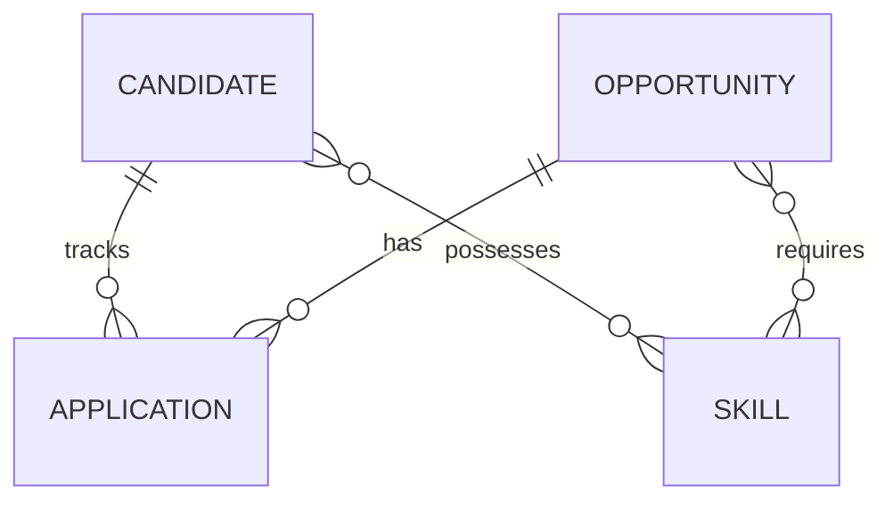

# CareerOps — Opportunity & Explainable Job-Fit Tracker

> A production-grade, offline-first career management platform featuring multi-criteria opportunity discovery, resume extraction, explainable heuristic job-fit scoring, application pipeline tracking, and optional grounded AI review.

---

## 1. Project Overview

**CareerOps** is designed to address the frustration early-career candidates experience when navigating fragmented job portals and black-box applicant tracking systems. Instead of guessing why an application failed, CareerOps computes a transparent, explainable job-fit score grounded in the candidate's actual resume, skills, and background.

The core architecture operates **100% offline**: resume parsing, structural quality checks, keyword categorization, and mathematical similarity scoring run locally within the Spring Boot application without requiring third-party cloud services or paid APIs. AI features are purely an optional enhancement.

---

## 2. Problem Statement

1. **Opaque Screening**: Most platforms score candidates using undisclosed algorithms without explaining which skills are missing or how to improve.
2. **Scattered Tracking**: Students apply across LinkedIn, company portals, Hackathons, and CTFs, losing track of deadlines, follow-ups, and interview stages.
3. **Fragile AI Dependencies**: Many modern tools break if external AI APIs hit rate limits or downtime. CareerOps ensures all critical workflows function offline.

---

## 3. Offline / Online Feature Matrix

| Feature | Offline (Core Engine) | AI (Optional Enhancement) |
| :--- | :---: | :---: |
| **Authentication & Registration** | **YES** | NO |
| **CRUD for All Entities** | **YES** | NO |
| **Pagination & Sorting** | **YES** | NO |
| **Resume Text Extraction (PDF/DOCX)** | **YES** (Apache Tika) | NO |
| **Resume Structural Quality Analysis** | **YES** (Local Heuristics) | NO |
| **Skill Comparison (Matched vs Missing)** | **YES** | NO |
| **Job-Fit Score Calculation (0–100)** | **YES** (Multi-Factor Math) | NO |
| **Responsibility Cosine Text Similarity** | **YES** (Vector Math) | NO |
| **Application Pipeline Tracking** | **YES** | NO |
| **AI Resume Review & Strengths** | NO | **YES** (Grounded LLM) |
| **AI Role & Requirement Explanation** | NO | **YES** (Grounded LLM) |
| **AI Targeted Skill Gap Guidance** | NO | **YES** (Grounded LLM) |
| **AI Interview Preparation Tips** | NO | **YES** (Grounded LLM) |

*This demonstrates that AI is strictly an enhancement, not a runtime dependency.*

---

## 4. Key Features

- **Multi-Category Opportunity Discovery**: Manage and search across **Jobs**, **Internships**, **Hackathons**, and **CTF Competitions** with live keyword filtering, type filters, and pagination.
- **Deep Resume Extraction**: Parse PDF and DOCX files automatically on upload via Apache Tika into searchable candidate profiles.
- **Explainable Job-Fit Engine**:
  - **40% Skill Overlap**: Computes matched vs missing skills from the catalog.
  - **25% Responsibility Match**: Cosine similarity between resume experience and role description.
  - **20% Experience & Seniority**: Automated detection and comparison of year thresholds.
  - **15% Resume Structural Quality**: Detection of key sections, quantifiable metric density, and action verbs.
- **Pipeline Workflow Tracker**: Track opportunities across stages (`TO_APPLY`, `APPLIED`, `ASSESSMENT`, `INTERVIEW`, `OFFER`, `REJECTED`, `WITHDRAWN`) with next action dates, custom notes, and automatic duplicate application prevention.
- **Interactive Swagger & Postman**: Full interactive OpenAPI documentation and a ready-to-run 18-request Postman suite with automated token chaining.
- **Modern Responsive React UI**: High-contrast, clean UI built with React 18, Vite, and vanilla CSS tokens.

---

## 5. Technology Stack

### Backend
- **Java 17**
- **Spring Boot 3.3.4** (Spring Web MVC, Spring Data JPA, Spring Security, Spring Validation)
- **Database**: MySQL 8.4+ (Production/Dev), H2 In-Memory (Automated Testing)
- **Security**: Stateless JWT (`io.jsonwebtoken:jjwt` v0.12.6) + BCrypt password hashing
- **Resume Extraction**: Apache Tika (v2.9.2)
- **API Documentation**: SpringDoc OpenAPI / Swagger UI (v2.6.0)
- **Build Tool**: Maven

### Frontend
- **React 18**
- **Vite 5**
- **Vanilla CSS Tokens & Glassmorphism Aesthetics**
- **Fetch API with Bearer JWT Auth Interceptors**

---

## 6. Architecture & Entity Design

### Layered Architecture
```
[React SPA Frontend]
         │ (HTTP / JSON / JWT)
         ▼
[JwtAuthenticationFilter] ──► [Spring Security Context]
         │
         ▼
[REST Controllers] (Auth, Candidate, Opportunity, Application, Skill, JobFit)
         │
         ▼
[Service Layer] (JobFitService, ResumeParserService, ResumeQualityService, etc.)
         │
         ▼
[Spring Data JPA Repositories]
         │
         ▼
[MySQL Database / H2 Test Database]
```

### Entity Design (Exactly 4 Primary JPA Entities)



1. **`Candidate`**: Name, email (unique), password hash, headline, location, education, experience years, resume text, linked skills.
2. **`Opportunity`**: Title, organization, type (`FULL_TIME`, `INTERNSHIP`, `HACKATHON`, `CTF`), role family, description, location, work mode, deadline, active flag, required skills.
3. **`Application`**: Candidate foreign key, Opportunity foreign key, status (`TO_APPLY`, `APPLIED`, `INTERVIEW`, etc.), applied date, next action date, notes. **Enforces unique constraint** `(candidate_id, opportunity_id)` to prevent duplicate tracking.
4. **`Skill`**: Normalized skill name (unique) and category.

---

## 7. REST API List

Detailed API documentation with request/response samples is available in [careerops/docs/api.md](file:///c:/Users/sachi/Downloads/Application_management/careerops/docs/api.md) and through Swagger UI (`/swagger-ui.html`).

| Method | Endpoint | Access | Purpose |
| :--- | :--- | :--- | :--- |
| `POST` | `/api/auth/register` | Public | Register new candidate account |
| `POST` | `/api/auth/login` | Public | Authenticate candidate & obtain JWT |
| `GET` | `/api/skills` | Bearer | List skill catalog |
| `POST` | `/api/skills` | Bearer | Add new skill |
| `GET` | `/api/opportunities` | Public | List opportunities with filter, page & sort |
| `GET` | `/api/opportunities/closing-soon` | Public | JPQL query for deadlines in next N days |
| `GET` | `/api/opportunities/{id}` | Public | Get opportunity details & required skills |
| `POST` | `/api/opportunities` | Bearer | Create opportunity |
| `PUT` | `/api/opportunities/{id}` | Bearer | Update opportunity |
| `DELETE` | `/api/opportunities/{id}` | Bearer | Delete opportunity |
| `GET` | `/api/opportunities/{id}/fit` | Bearer | Calculate explainable offline job fit |
| `POST` | `/api/opportunities/{id}/ai-review`| Bearer | Run optional AI review |
| `GET` | `/api/candidates/me` | Bearer | Get authenticated candidate profile |
| `PUT` | `/api/candidates/me` | Bearer | Update profile & link skills |
| `POST` | `/api/candidates/me/resume` | Bearer | Upload and parse PDF/DOCX resume |
| `GET` | `/api/candidates/me/resume-analysis` | Bearer | Offline resume structure analysis |
| `GET` | `/api/applications` | Bearer | List candidate applications (paged/sorted) |
| `GET` | `/api/applications/stats` | Bearer | Get aggregated stage statistics |
| `POST` | `/api/applications` | Bearer | Track opportunity (duplicate guarded) |
| `PUT` | `/api/applications/{id}` | Bearer | Update application status & notes |
| `DELETE` | `/api/applications/{id}` | Bearer | Untrack application |

---

## 8. Setup & Execution Guide

### 8.1 Prerequisites
- **Java 17+** (JDK installed)
- **MySQL Server 8.4+**
- **Node.js 18+ & npm**

### 8.2 Database Setup
Create the MySQL database:
```sql
CREATE DATABASE careerops CHARACTER SET utf8mb4 COLLATE utf8mb4_unicode_ci;
```

### 8.3 Environment Variables
Configure your environment by copying `.env.example` to `.env` or setting system environment variables:

```bash
# Database
DB_URL=jdbc:mysql://localhost:3306/careerops?useSSL=false&allowPublicKeyRetrieval=true&serverTimezone=UTC
DB_USERNAME=root
DB_PASSWORD=your_password

# Server & Security
SERVER_PORT=8080
JWT_SECRET=a_very_secure_and_long_secret_key_with_at_least_32_characters
JWT_EXPIRATION_MINUTES=120

# Offline Heuristic Fit Weights (Must sum to 100)
FIT_SKILL_WEIGHT=40
FIT_RESPONSIBILITY_WEIGHT=25
FIT_EXPERIENCE_WEIGHT=20
FIT_RESUME_WEIGHT=15

# Optional AI Integration (OpenAI-compatible or Ollama)
AI_ENABLED=false
AI_BASE_URL=http://localhost:11434/v1
AI_API_KEY=your_key_if_applicable
AI_MODEL=llama3.2
```

### 8.4 Running Backend
```bash
cd careerops
mvn clean spring-boot:run
```
- Swagger UI will be available at: `http://localhost:8080/swagger-ui.html`
- OpenAPI JSON specification: `http://localhost:8080/api-docs`

### 8.5 Running Frontend
```bash
cd careerops-ui
npm install
npm run dev
```
Open your browser at `http://localhost:5173`.

---

## 9. Automated Testing & Postman

### 9.1 Automated Tests
Run the test suite using:
```bash
cd careerops
mvn test
```
The test suite utilizes the dedicated `test` profile with an in-memory H2 database to verify:
- Registration and login success & rejection
- Opportunity full CRUD, pagination, and sorting
- Application tracking and duplicate prevention (HTTP 409 Conflict)
- Heuristic job-fit scoring mathematics and boundary conditions
- Jakarta validation failures and structured error responses

### 9.2 Postman Collection
Import the collection and environment located in `careerops/postman/`:
- `CareerOps.postman_collection.json`
- `CareerOps.postman_environment.json`

The collection automatically stores the JWT token upon running `01. Auth - Register` or `02. Auth - Login` and chains entity IDs (`{{opportunityId}}`, `{{applicationId}}`, `{{skillId}}`) dynamically across all 18 demonstration endpoints.

---

## 10. Recommended College Demo Flow (5–8 Minutes)

1. **Registration & Login**: Open `http://localhost:5173`, register as a candidate, observe JWT issuance.
2. **Profile & Resume Upload**: Navigate to the Resume page, upload a sample PDF/DOCX resume, and observe instant text extraction via Apache Tika.
3. **Offline Resume Analysis**: Review the detected sections (Experience, Projects, Education), action verbs, and quantifiable metrics.
4. **Opportunity Exploration**: Browse opportunities, sort by deadline/creation date, and filter by "Internship" or keyword.
5. **Job-Fit Breakdown**: Click an opportunity's **Fit Score** button to inspect the explainable breakdown: matched vs missing skills, experience eligibility, and actionable improvement steps.
6. **Application Pipeline**: Track the opportunity as `TO_APPLY`, transition it to `APPLIED` with interview notes, and demonstrate dashboard statistics.
7. **Swagger UI Walkthrough**: Open `/swagger-ui.html` and present the clean Controller-Service-Repository architecture and error responses.

---

## 11. Team Contributions (4-Member Role Mapping)

| Team Member | Domain Responsibility | Key Deliverables |
| :--- | :--- | :--- |
| **Member 1** | **Backend & Persistence Core** | JPA Entities (`Candidate`, `Opportunity`, `Application`, `Skill`), Spring Data Repositories, Derived & JPQL Queries, MySQL schema, and Database Constraints. |
| **Member 2** | **Security & REST API** | Stateless JWT Filter, Spring Security configuration, BCrypt hashing, Jakarta Validation, Global Exception Handling, and Swagger/OpenAPI setup. |
| **Member 3** | **Job-Fit & Heuristic Engine** | Apache Tika resume parser, Offline Resume Quality Analyzer, Cosine Vector similarity calculations, and Multi-factor Job-Fit algorithm. |
| **Member 4** | **Frontend, Testing & AI Integration** | React SPA, Dashboard UI, Pipeline tracker, Optional AI review integration, JUnit 5 integration tests, Postman collection, and documentation. |

---

## 12. Documentation Index

- [Architecture Overview](file:///c:/Users/sachi/Downloads/Application_management/careerops/docs/architecture.md)
- [Entity Design & ERD](file:///c:/Users/sachi/Downloads/Application_management/careerops/docs/entity-design.md)
- [REST API Specification](file:///c:/Users/sachi/Downloads/Application_management/careerops/docs/api.md)
- [Testing Documentation](file:///c:/Users/sachi/Downloads/Application_management/careerops/docs/testing.md)
- [Hiring Guidance & Research Paper](file:///c:/Users/sachi/Downloads/Application_management/careerops/docs/research/hiring-guidance.md)
- [Implementation & Build Log](file:///c:/Users/sachi/Downloads/Application_management/careerops/docs/build-log.md)
