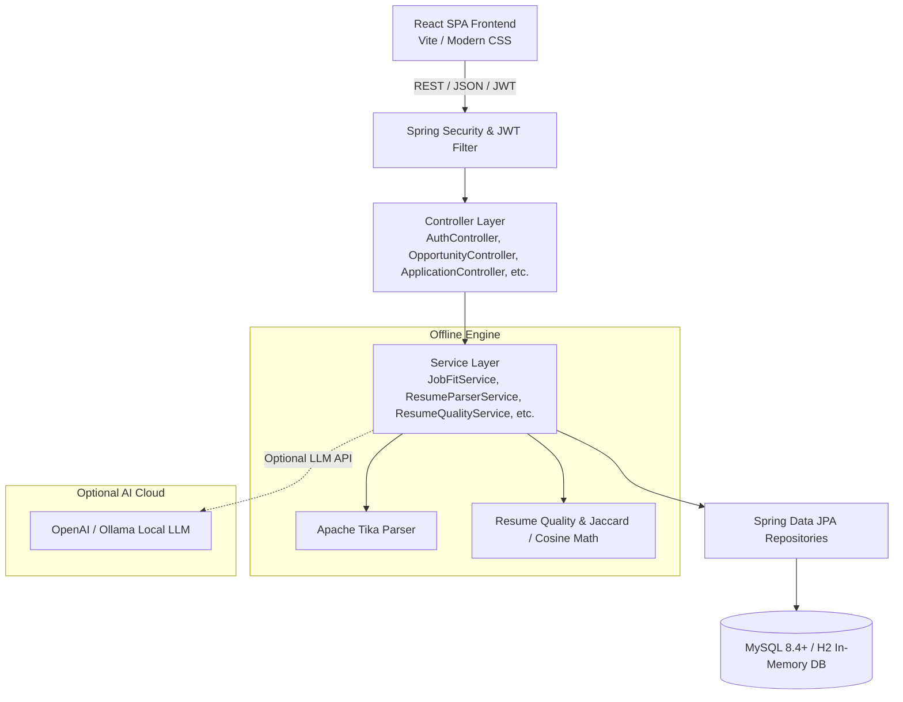

# Architecture Documentation — CareerOps

## 1. System Overview

**CareerOps** is a dual-component full-stack web application designed for tracking career opportunities (Full-time Jobs, Internships, Hackathons, CTFs) and computing transparent, explainable job-fit scores.

The architecture emphasizes:
- **Offline-First Core**: Core scoring, validation, text similarity, and resume quality heuristics operate entirely offline inside the JVM without external API dependencies.
- **Layered Enterprise Pattern**: Standard Spring Boot 3 multi-tier architecture (`Controller` -> `Service` -> `Repository` -> `Database`).
- **Secure by Default**: Stateless JWT authentication with BCrypt password hashing and CORS configuration.
- **Decoupled Modern Frontend**: Fast, responsive React single-page application built with Vite and pure CSS tokens.

---

## 2. Component Architecture Diagram

---

## 3. Layered Design

### 3.1 Presentation Layer (Frontend)
- Built with React 18 and Vite.
- Communicates exclusively via standard REST endpoints with Bearer JWT tokens stored securely in memory / local state.
- Features: Opportunity discovery cards, derived filtering, status pipelines (TO_APPLY, APPLIED, INTERVIEW, OFFER, REJECTED), resume upload dropzone, and explainable fit score breakdowns.

### 3.2 Security & Filter Layer
- `JwtAuthenticationFilter` intercepts requests, validates Bearer tokens via HMAC-SHA256, extracts the candidate's subject email, and sets the `SecurityContext`.
- Public routes: `/api/auth/**`, `/swagger-ui/**`, `/v3/api-docs/**`, and `GET /api/opportunities/**`.
- Protected routes: Profile `/api/candidates/**`, tracker `/api/applications/**`, and mutation endpoints (`POST`, `PUT`, `DELETE`).

### 3.3 Controller Layer
- Pure REST controllers annotated with `@RestController` and OpenAPI `@Tag` annotations.
- Direct mapping to DTO records (`Request` / `Response`).
- Strict request validation using Jakarta Validation (`@Valid`, `@NotBlank`, `@NotNull`, `@Size`).

### 3.4 Service Layer
- Concrete Spring `@Service` implementations without redundant interface boilerplate.
- Transaction management via `@Transactional`.
- Heuristic job-fit scoring engine aggregating skill overlap, responsibility cosine similarity, experience checks, and resume structural health.

### 3.5 Persistence Layer
- Exactly 4 primary JPA entities: `Candidate`, `Opportunity`, `Application`, `Skill`.
- Optimized derived queries and JPQL queries with pagination (`Pageable`) and sorting (`Sort`).
- Cascade rules and unique constraints (`uk_candidate_opportunity`) preventing accidental duplicate applications.

---

## 4. Scalability & Extensibility
1. **Stateless Session Management**: No server-side session state allows horizontal scaling behind reverse proxies (Nginx/Traefik).
2. **Pluggable AI Integration**: `AiAnalysisService` safely decouples optional LLM prompts. If disabled or failing, the application degrades gracefully to offline heuristic results.
3. **Database Portability**: Clean JPA/Hibernate dialect configurations allow zero-code switching between local development MySQL, enterprise PostgreSQL, and in-memory H2 test fixtures.
