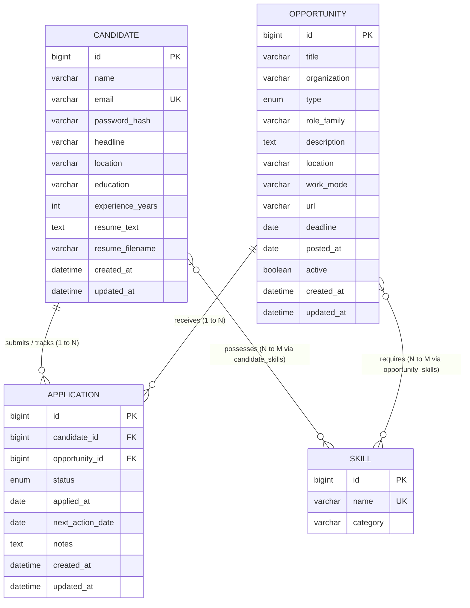

# Entity Design & Data Model — CareerOps

## 1. Overview & Constraints

To prevent over-engineering while maintaining realistic enterprise relationships, CareerOps maintains **exactly 4 primary JPA entities**:

1. **`Candidate`**: Represents the job seeker, account profile, uploaded resume text, and work preferences.
2. **`Opportunity`**: Represents open career postings (Full-time jobs, Internships, Hackathons, CTF competitions).
3. **`Application`**: Represents the candidate's tracked pipeline progress for a specific opportunity.
4. **`Skill`**: A normalized catalog entity representing technical and domain competencies.

---

## 2. Entity-Relationship Diagram (ERD)



---

## 3. Relationships and Cardinality

| From Entity | To Entity | Cardinality | Join Table / Foreign Key | On Delete / Cascade Rule |
| :--- | :--- | :--- | :--- | :--- |
| **Candidate** | **Application** | `1 to N` | `application.candidate_id` | `CascadeType.ALL`, `orphanRemoval = true` |
| **Opportunity** | **Application** | `1 to N` | `application.opportunity_id` | Cascade delete blocked or application preserved |
| **Candidate** | **Skill** | `N to M` | `candidate_skills (candidate_id, skill_id)` | ManyToMany unidirectional / bidirectional |
| **Opportunity** | **Skill** | `N to M` | `opportunity_skills (opportunity_id, skill_id)` | ManyToMany unidirectional |

---

## 4. Key Constraints and Rules

1. **Unique Email Constraint**:
   `Candidate.email` has a unique constraint (`@Column(unique = true)`).
2. **Duplicate Application Prevention**:
   `Application` enforces a compound unique constraint:
   ```sql
   CONSTRAINT uk_candidate_opportunity UNIQUE (candidate_id, opportunity_id)
   ```
   A candidate cannot track the same opportunity more than once. Attempting to track again throws `DataIntegrityViolationException`, which the global exception handler converts into HTTP 409 Conflict.
3. **Enumerations**:
   - `OpportunityType`: `FULL_TIME`, `INTERNSHIP`, `HACKATHON`, `CTF`
   - `ApplicationStatus`: `TO_APPLY`, `APPLIED`, `ASSESSMENT`, `INTERVIEW`, `OFFER`, `REJECTED`, `WITHDRAWN`
