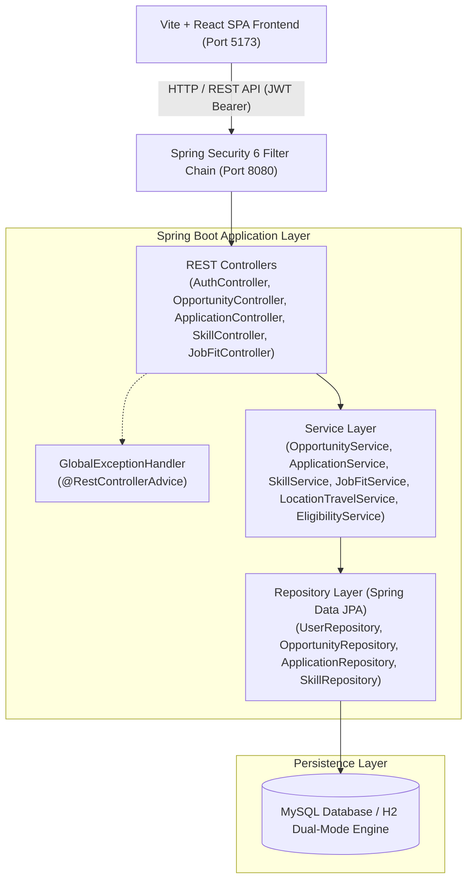
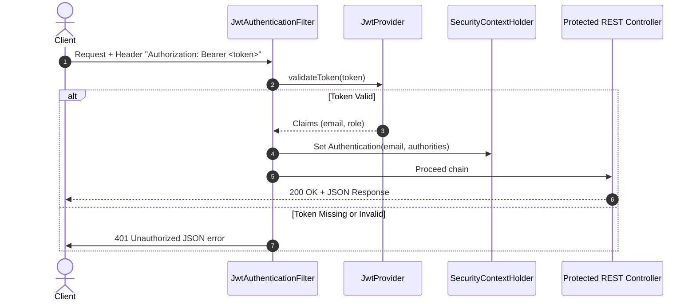
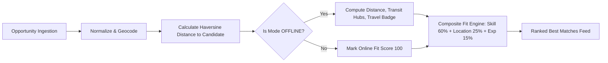

# CareerOps System Architecture

## 1. Architectural Overview
CareerOps follows a clean, layered enterprise architecture built around Spring Boot 3.x, Spring Data JPA, Spring Security 6, and a responsive Single Page Application (SPA) frontend.



---

## 2. Layered Responsibilities

### 2.1 Controller Layer (`com.careerops.app.controller`)
- Exposes standardized RESTful endpoints following HTTP verb semantics (`GET`, `POST`, `PUT`, `DELETE`).
- Validates incoming request payloads using Jakarta Bean Validation (`@Valid`, `@NotNull`, `@NotBlank`, `@Email`, `@Size`).
- Parses URL path variables, request parameters, pagination (`Pageable`), and sorting specifications (`Sort`).
- Returns proper HTTP status codes:
  - `200 OK`: Successful read or update operations.
  - `201 Created`: Successful entity creation with resource representation.
  - `204 No Content`: Successful deletions.
  - `400 Bad Request`: Validation failures or malformed inputs.
  - `401 Unauthorized`: Missing or invalid JWT token.
  - `403 Forbidden`: Authenticated user lacks permission.
  - `404 Not Found`: Requested resource does not exist.
  - `409 Conflict`: Unique constraint violation or duplicate entry.

### 2.2 Service Layer (`com.careerops.app.service`)
- Enforces core business logic, transactional consistency (`@Transactional`), and entity life-cycle workflows.
- Key services:
  - `AuthService`: User and candidate registration, BCrypt password encryption, credential authentication, and JWT token issuance.
  - `OpportunityService`: Search, filtering, deduplication, ingestion pipelines, closing-soon alerts, and nearby geolocation computations.
  - `ApplicationService`: Application tracking, status state transitions, duplicate prevention, and user analytics statistics.
  - `SkillService`: Master skill taxonomy management and duplicate prevention.
  - `JobFitService`: Weighted algorithmic fit evaluation across skills, experience, education, and location.
  - `LocationTravelService`: Haversine distance computations, Indian transit intelligence, travel necessity badges, and accommodation detection.
  - `EligibilityService`: Batch, degree, and prerequisite qualification evaluations.

### 2.3 Repository Layer (`com.careerops.app.repository`)
- Built upon Spring Data JPA `JpaRepository`.
- Combines:
  1. **Derived Query Methods**: E.g., `findByType(OpportunityType type)`, `findByLocationContainingIgnoreCase(String location)`, `findByStatus(ApplicationStatus status)`.
  2. **Custom JPQL Queries**: E.g., `findActiveByType`, `findClosingSoon`, `findApplicationsByUserId`.
- Transparent pagination (`Page<T>`) and sorting (`Sort`) handled directly in database queries.

### 2.4 Persistence Layer
- Managed by Hibernate ORM with MySQL 8.x dialect.
- Automatic failover to file-based H2 database (`./data/careerops.mv.db`) in MySQL compatibility mode (`MODE=MySQL`) when external MySQL server is offline during development or offline test grading.

---

## 3. Security Architecture



### 3.1 Security Features
- **Stateless Session Management**: `SessionCreationPolicy.STATELESS` ensures scalability and zero server-side session memory overhead.
- **BCrypt Password Hashing**: Passwords are encrypted with BCrypt (10 rounds) upon registration and stored securely. Plaintext passwords are never logged or returned (`@JsonIgnore` on User entity).
- **JWT Authentication**: Tokens signed with secure HMAC SHA key (`SECRET_KEY`), with expiration handling and email-based claims.
- **CORS Configuration**: Configured to permit authorized origins (`http://localhost:5173`, `http://localhost:3000`) for all headers and verbs (`GET`, `POST`, `PUT`, `DELETE`, `OPTIONS`).

---

## 4. Opportunity Discovery & Travel Intelligence Engine



1. **Geolocation Resolution**: Automatic resolution of candidate's base city (e.g., Chennai, Bangalore, Mumbai, Delhi) and opportunity venue city.
2. **Haversine Formula**: Calculates great-circle distance in kilometers:
   $$d = 2r \arcsin\left(\sqrt{\sin^2\left(\frac{\Delta \phi}{2}\right) + \cos(\phi_1)\cos(\phi_2)\sin^2\left(\frac{\Delta \lambda}{2}\right)}\right)$$
3. **Travel Intelligence Attributes**:
   - `travelRequired`: Boolean flag (false for online, true for offline non-local).
   - `distanceKm`: Geodesic distance in kilometers.
   - `accommodationRequired`: Set to true for offline multi-day events.
   - `travelBadge`: Display labels (🟢 Online / Free, 🟡 Local Drive, 🔴 Inter-city Travel).

---

## 5. Error Handling & Validation Architecture
The application strictly adheres to standardized JSON error responses.

- **Jakarta Bean Validation**:
  - Validates constraints before invoking controller logic.
  - Capture `@NotNull`, `@NotBlank`, `@Size`, `@Email` violations.
- **Global Exception Handler (`@RestControllerAdvice`)**:
  - Translates domain exceptions into structured JSON responses containing:
    ```json
    {
      "timestamp": "2026-10-05T21:10:00",
      "status": 404,
      "error": "Not Found",
      "message": "Opportunity not found with id: 42",
      "path": "/api/opportunities/42"
    }
    ```
  - Prevents stack traces or internal implementation leaks in production responses.
