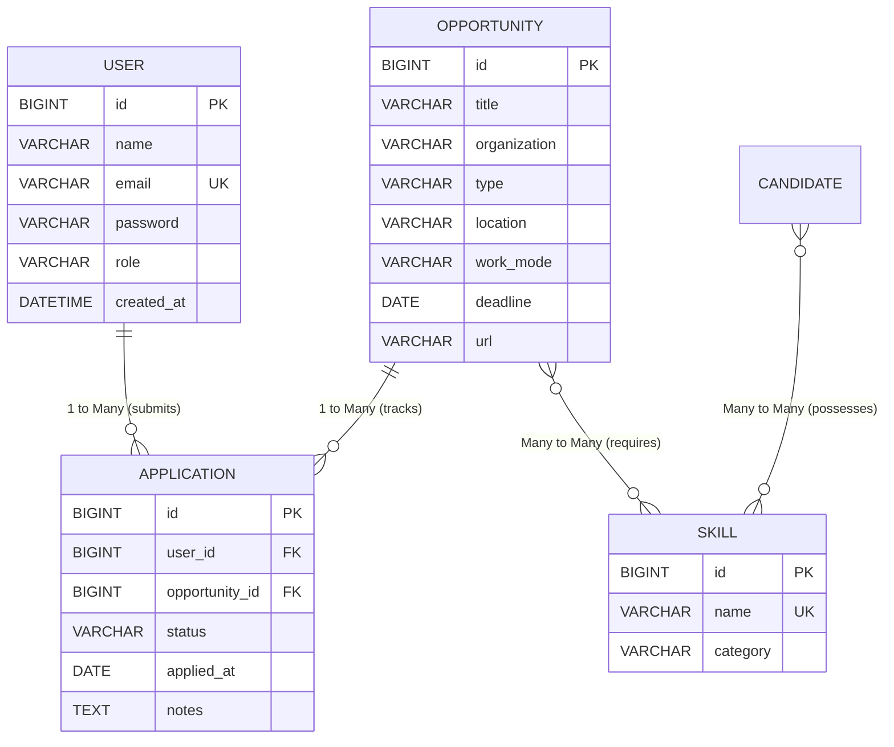

# CareerOps Entity & Database Design

## 1. Overview
CareerOps implements a robust, normalized relational data model managed by Spring Data JPA and persisted in MySQL. The core domain is designed around career opportunity discovery, qualification fit matching, and application lifecycle tracking.

---

## 2. Core Entities

### 2.1 User Entity (`users`)
Represents an authenticated platform account for candidates and students.
- **Table Name**: `users`
- **Fields**:
  - `id` (`BIGINT`, PK, Auto-increment): Unique identifier.
  - `name` (`VARCHAR(255)`, Not Null): User's full name.
  - `email` (`VARCHAR(255)`, Not Null, Unique): Validated email address used for login.
  - `password` (`VARCHAR(255)`, Not Null): BCrypt hashed password (never exposed in API responses).
  - `role` (`VARCHAR(30)`, Default `'ROLE_USER'`): Authorization role.
  - `created_at` (`DATETIME`, Not Null, Updatable False): Timestamp of account creation.

### 2.2 Opportunity Entity (`opportunity`)
Represents career and academic events across India (Jobs, Internships, Hackathons, CTF Competitions, Fellowships, Competitions, Scholarships).
- **Table Name**: `opportunity`
- **Fields**:
  - `id` (`BIGINT`, PK, Auto-increment): Unique identifier.
  - `title` (`VARCHAR(255)`, Not Null): Opportunity title.
  - `organization` (`VARCHAR(255)`): Company, college, or host institution.
  - `description` (`TEXT`): Detailed job/event description, eligibility criteria, and problem statements.
  - `type` / `opportunity_type` (`VARCHAR(50)`, Enum): `JOB`, `INTERNSHIP`, `HACKATHON`, `CTF_COMPETITION`, `FELLOWSHIP`, `CODING_COMPETITION`, `QUIZ`, `INNOVATION_CHALLENGE`, `RESEARCH_COMPETITION`, `STUDENT_COMPETITION`, `SCHOLARSHIP`, `OTHER`.
  - `location` (`VARCHAR(255)`): City/State (e.g., Chennai, Tamil Nadu).
  - `city` (`VARCHAR(100)`): Extracted Indian city for geolocation.
  - `state` (`VARCHAR(100)`): Indian State/UT.
  - `country` (`VARCHAR(100)`, Default `'India'`): Country.
  - `venue` (`VARCHAR(255)`): Physical venue or campus hall.
  - `work_mode` (`VARCHAR(30)`): `ONLINE`, `HYBRID`, `OFFLINE` / `REMOTE`, `ON_SITE`.
  - `eligibility` (`TEXT`): Eligible degrees, batches, or age limits.
  - `experience_requirement` (`VARCHAR(50)`): Required years of experience.
  - `education_requirement` (`VARCHAR(255)`): Degree requirements (e.g., B.Tech in CS/IT).
  - `deadline` (`DATE`): Application closing date.
  - `registration_deadline` (`DATE`): Event registration deadline.
  - `event_start_date` (`DATE`): Event kickoff date.
  - `event_end_date` (`DATE`): Event conclusion date.
  - `url` / `external_url` (`VARCHAR(255)`): Official registration link.
  - `source` (`VARCHAR(50)`): Discovery source code.
  - `external_job_id` (`VARCHAR(100)`): Source-specific external identifier.
  - `normalized_title` (`VARCHAR(255)`): Lowercased title for deduplication.
  - `active` (`BOOLEAN`, Default `TRUE`): Flag indicating if opportunity is active.
  - `created_at` (`DATETIME`): Ingestion timestamp.
  - `updated_at` (`DATETIME`): Last modification timestamp.

### 2.3 Application Entity (`application`)
Connects a User to an Opportunity to track their progress through the hiring or competition lifecycle.
- **Table Name**: `application`
- **Fields**:
  - `id` (`BIGINT`, PK, Auto-increment): Unique identifier.
  - `user_id` (`BIGINT`, FK to `users.id`): Associated user.
  - `candidate_id` (`BIGINT`, FK to `candidate.id`): Associated candidate profile.
  - `opportunity_id` (`BIGINT`, FK to `opportunity.id`, Not Null): Target opportunity.
  - `status` (`VARCHAR(20)`, Enum, Not Null): `TO_APPLY`, `APPLIED`, `IN_PROGRESS`, `INTERVIEW`, `SELECTED`, `REJECTED`, `INTERESTED`, `REGISTERED`, `PARTICIPATING`, `COMPLETED`.
  - `applied_at` (`DATE`): Date the application or registration was submitted.
  - `next_action_date` (`DATE`): Optional reminder or interview date.
  - `notes` (`TEXT`): Candidate preparation notes and status updates.
  - `created_at` (`DATETIME`, Not Null): Application tracking creation timestamp.
  - `updated_at` (`DATETIME`): Last status change timestamp.

### 2.4 Skill Entity (`skill`)
Catalog of technical and professional skills used for candidate tagging and automated fit engine calculations.
- **Table Name**: `skill`
- **Fields**:
  - `id` (`BIGINT`, PK, Auto-increment): Unique identifier.
  - `name` (`VARCHAR(100)`, Not Null, Unique): Skill name (e.g., Java, Python, Wireshark, Docker).
  - `category` (`VARCHAR(100)`): Skill category (e.g., Security, Backend, Cloud, Data).
  - `created_at` (`DATETIME`, Not Null): Registration timestamp.

---

## 3. JPA Relationships

1. **User 1 → Many Applications (`@OneToMany` / `@ManyToOne`)**:
   - Each user can track multiple applications.
   - Enforced by foreign key `user_id` on the `application` table.
2. **Opportunity 1 → Many Applications (`@OneToMany` / `@ManyToOne`)**:
   - Each opportunity can be tracked by multiple applicants.
   - Enforced by foreign key `opportunity_id` on the `application` table.
   - Enforced unique constraint: `(candidate_id, opportunity_id)` or `(user_id, opportunity_id)` prevents accidental duplicate tracking.
3. **Opportunity Many ↔ Many Skills (`@ManyToMany`)**:
   - Join table: `opportunity_skill (opportunity_id, skill_id)`.
4. **Candidate Many ↔ Many Skills (`@ManyToMany`)**:
   - Join table: `candidate_skill (candidate_id, skill_id)`.

---

## 4. Database Constraints & Indexes
- **Unique Constraints**:
  - `users.email` (unique index)
  - `skill.name` (unique index)
  - `uk_candidate_opportunity` on `(candidate_id, opportunity_id)`
- **Composite Indexes**:
  - `idx_opp_type_deadline` on `opportunity(type, deadline)`
  - `idx_opp_city_state` on `opportunity(city, state)`
  - `idx_opp_active_deadline` on `opportunity(active, deadline)`
  - `idx_notif_candidate_created` on `notification(candidate_id, created_at)`
